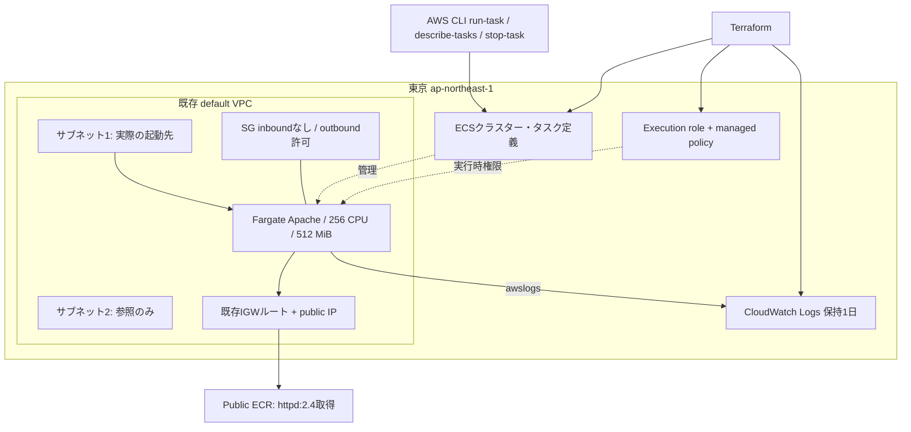

# AWS ECS Fargate × Terraform 技術ポートフォリオ

2026年10月23日（JST）実施／mika-it-labs

Terraformによる構築から、AWS CLIでの起動・稼働確認・ログ検証・停止・削除・権限整理までを記録した個人演習です。

## 成果と構成

|項目|設定・結果|
|---|---|
|IaC|Terraform 1.5以上、AWS provider `~> 6.0`|
|リージョン|東京 `ap-northeast-1`|
|ネットワーク|既存default VPC、参照結果は2サブネット|
|実行|ECSクラスター、Fargate単発タスク、awsvpc|
|コンテナ|`public.ecr.aws/docker/library/httpd:2.4`|
|サイズ|CPU 256（0.25 vCPU）／メモリ512 MiB|
|権限|execution role + AmazonECSTaskExecutionRolePolicy|
|ログ|CloudWatch Logs、保持1日、awslogs|
|通信|SG inboundなし、IPv4 outbound許可、public IP有効|
|検証|タスク・コンテナRUNNING、Apache正常起動ログ|
|片付け|停止待機、destroy、権限不足対応後の再destroy、state空|



2サブネットのうち、当日は最初の1サブネットで1タスクを起動しました。ECSサービス、ALB、マルチAZ冗長化は対象外です。public IPがあってもinboundを許可していないため、外部からのHTTP疎通を成果とはしていません。

## 資料

1. [提出用サマリー](docs/summary.md)
2. [構築・操作手順](docs/procedure.md)
3. [検証結果・根拠](docs/verification.md)
4. [トラブルシュート](docs/troubleshooting.md)
5. [学びと改善案](docs/learnings.md)
6. [停止・削除](docs/cleanup.md)
7. [Terraformコード](terraform/)

## コードと証跡の出所

ローカル演習ディレクトリから元の `.tf` 6ファイルを取得し、`terraform/` にそのまま収録しました。取得時コードと添付ログの構成は整合しますが、当日の実行時点とのバイト単位の同一性までは証明していません。再構成コードではありません。元のtfvars、state、キャッシュ、未加工ログ、認証情報は収録していません。

検証結果は会話添付の作業ログを匿名化・要約したものです。公開準備時にAWSへの再デプロイは行っていません。`httpd:2.4` は可変タグ、providerは6系の範囲指定であり、当日の正確なバージョン固定ではありません。

## 再実行

PowerShell、Terraform 1.5以上、AWS CLI v2、適切な権限を持つローカルの `training` プロファイルが必要です。料金が発生するため停止・削除まで実施してください。

```powershell
cd terraform
terraform init
terraform fmt -check
terraform validate
terraform plan
terraform apply
```

既存default VPCに利用可能なサブネットとインターネット向けルートが必要です。コードはVPC内のサブネットを検索するため、環境により件数や順序が変わります。詳細は操作手順を参照してください。

## 参考資料

- [AWS: Fargateタスクのネットワーキング](https://docs.aws.amazon.com/AmazonECS/latest/developerguide/fargate-task-networking.html)
- [AWS: タスク実行IAMロール](https://docs.aws.amazon.com/AmazonECS/latest/developerguide/task_execution_IAM_role.html)
- [HashiCorp: ECS task definition](https://registry.terraform.io/providers/hashicorp/aws/latest/docs/resources/ecs_task_definition)

参考資料は設計説明に使用し、実施結果は当日の作業ログに基づきます。

## 公開前検査

整形検査は成功しました。validateは環境のprovider応答エラーにより完了していません。取得時のlock file（AWS 6.70.0）を収録しましたが、当日の版と同一とは断定しません。[検査記録](docs/publication-checks.md)を参照してください。
