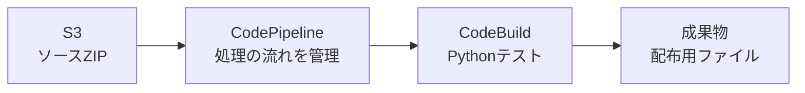

# AWSインフラ学習ラボ

AWSの開発・運用の流れを、学習記録・操作手順・サンプルコードでまとめたリポジトリです。

S3に置いたソースを自動テストするCI、EC2の管理とデプロイの準備、IAMの権限設定、学習後のリソース削除を扱います。ECS/Fargate・Terraformについては、今後の学習計画と既存の演習資料を収録しています。

## 学習の全体像

学習内容は、大きく3つに分かれます。

### 1. ソースを受け取り、自動でテストする

S3にソースZIPを配置し、CodePipelineで処理の流れを管理します。CodeBuildがPythonテストを実行し、配布に使うファイルを成果物として出力します。



### 2. EC2を管理し、デプロイに必要な仕組みを学ぶ

SSMでEC2を管理する方法と、CodeDeploy Agent、配布ファイル、検証スクリプトの役割を整理しています。

|要素|役割|
|---|---|
|EC2|アプリケーションの配置先となるサーバー|
|SSM|EC2への接続・管理|
|CodeDeploy Agent|EC2上でCodeDeployの配布処理を実行|
|appspec.yml|ファイルの配置先と、配布時に実行する処理を定義|
|validate.sh|配置後の動作を確認|
|ZIP|ソースや配布ファイルをひとつにまとめる|

CIの学習とEC2へのデプロイ準備を扱っています。CodePipelineからEC2までの自動デプロイ完了は、確認済みの成果には含めていません。

### 3. 権限を確認し、後片付けまで行う

サービスごとに必要なIAMロールを整理し、エラーが起きたときの確認方法を学びます。学習後は、EC2・S3・ログ・IAMなどの残存リソースと料金を確認します。

## 目的別の読み方

|知りたいこと|読む資料|
|---|---|
|学習内容を短く把握したい|[学習サマリー](docs/summary.md)|
|どこまで学習したか確認したい|[学習記録](docs/learning-record.md)|
|CIとEC2の手順を復習したい|[操作手順](docs/procedure.md)|
|IAMロールの違いを理解したい|[IAMの役割と権限](docs/iam.md)|
|エラーの調べ方を知りたい|[障害の切り分け](docs/troubleshooting.md)|
|学習後の削除対象を確認したい|[削除・残存・料金の確認](docs/cleanup.md)|
|コードを動かして復習したい|[Python・CI・EC2向けサンプル](examples/ci-ec2/README.md)|
|次にECSとTerraformを学びたい|[ECS/Fargate・Terraform学習計画](docs/ecs-terraform-plan.md)|

## サンプルコードを試す

[examples/ci-ec2/](examples/ci-ec2/)には、復習用に作成した最小構成のサンプルがあります。

|ファイル|内容|
|---|---|
|[app.py](examples/ci-ec2/app.py)|テスト対象のPythonプログラム|
|[tests/test_app.py](examples/ci-ec2/tests/test_app.py)|Pythonの単体テスト|
|[buildspec.yml](examples/ci-ec2/buildspec.yml)|CodeBuildで実行するテストと成果物の指定|
|[appspec.yml](examples/ci-ec2/appspec.yml)|EC2向けのファイル配置と検証処理の指定|
|[scripts/validate.sh](examples/ci-ec2/scripts/validate.sh)|配置後のテストと出力確認|
|[package.py](examples/ci-ec2/package.py)|必要なファイルだけをZIPにまとめる処理|

Pythonを用意し、リポジトリのルートから次のコマンドを実行します。

```sh
cd examples/ci-ec2
python -m unittest discover -s tests -v
python app.py
```

ローカル検証ではテスト3件の成功と、アプリの出力 `5` を確認しています。ZIP作成やAWSでの利用方法は[サンプルの説明](examples/ci-ec2/README.md)を参照してください。

## ECS/Fargate・Terraformの資料

この学習の次のステップとして、コンテナ基盤の構築・起動・ログ確認・削除をTerraformとAWS CLIで学ぶ計画をまとめています。

- [今後の学習計画](docs/ecs-terraform-plan.md)
- [既存のTerraformコード](terraform/)
- [以前のECS/Terraform演習資料](archive/ecs-terraform-original/README.md)

以前の演習資料は、今回のCI・EC2学習記録と分けて保存しています。

## 記録と検証について

学習記録は実施者から提供された内容をもとに整理しています。復習用サンプルは新規作成したもので、当時のコードの復元ではありません。AWS上でのサンプル動作は未検証です。

確認できた範囲や検査結果の詳細は、[検証範囲](docs/verification.md)と[公開時の確認](docs/publication-checks.md)に記載しています。
